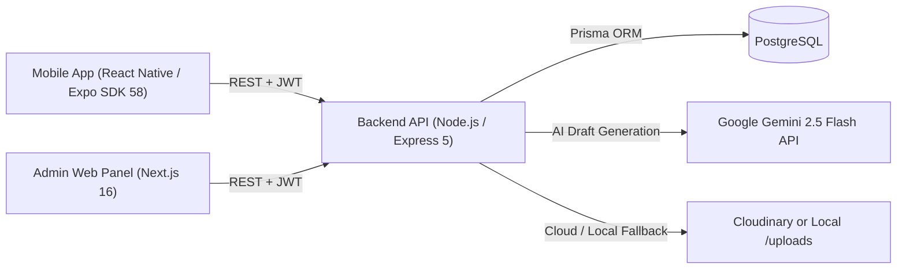

# Central NHCE — Campus Announcement & Newsletter Platform

A full-stack campus communication platform built to streamline official college announcements, academic circulars, AI-assisted notice drafting, and monthly newsletters across **Administrators**, **Faculty**, **Students**, and **Alumni**.

---

## Table of Contents
- [Overview](#overview)
- [Architecture & Tech Stack](#architecture--tech-stack)
- [Features by Role](#features-by-role)
- [Database Schema](#database-schema)
- [Project Structure](#project-structure)
- [Prerequisites](#prerequisites)
- [Quick Start (Windows Demo Script)](#quick-start-windows-demo-script)
- [Manual Setup Guide](#manual-setup-guide)
- [Demo Accounts](#demo-accounts)
- [REST API Reference](#rest-api-reference)

---

## Overview

Colleges often rely on fragmented messaging groups for notices, exam schedules, placement updates, and newsletters—causing important updates to get lost. **Central NHCE** solves this with a structured, role-based system:

- **Admins** onboard faculty members via a dedicated Next.js web portal and assign them to specific academic programs and departments.
- **Faculty** publish prioritized announcements (`PINNED`, `HIGH`, `INFO`) and monthly newsletters with multi-file attachments (images and PDFs) from the mobile app—and can use **Gemini AI (`gemini-2.5-flash`)** to auto-generate announcement drafts directly from uploaded notices, brochures, or posters.
- **Students** receive a filtered feed tailored to their **Program**, **Department**, and **Semester**, plus access to campus newsletters.
- **Alumni** can browse campus updates directly without student credentials.

---

## Architecture & Tech Stack



| Layer | Directory | Technologies |
| :--- | :--- | :--- |
| **Backend API** | `backend/` | Node.js, Express 5, Prisma ORM, PostgreSQL, JWT (`jsonwebtoken`), `bcrypt`, Multer, Cloudinary, Google Gemini (`gemini-2.5-flash`) |
| **Mobile App** | `mobile-app/` | React Native, Expo SDK 58, Expo Router, TypeScript/JavaScript, AsyncStorage, Expo Document Picker |
| **Admin Web Panel** | `admin-frontend/` | Next.js 16 (App Router), React 19, TypeScript, Tailwind CSS v4 |

---

## Features by Role

### Admin (Web Panel)
- Secure Admin sign-in (`/login`) backed by JWT authentication.
- Admin dashboard (`/dashboard`) to manage faculty onboarding.
- Dynamic Program → Department selection when creating faculty accounts (`/faculty/create`) with temporary passwords.

### Faculty (Mobile App)
- Unified login with automatic **forced password change** on first login (`isFirstLogin`).
- **AI-Assisted Announcement Drafting:** Upload a notice/brochure/poster/PDF and tap **Generate with AI** to auto-fill Title, Description, Priority (`PINNED`, `HIGH`, `INFO`), Semester, and Deadline using Google Gemini.
- **Create Announcements** with title, description, priority, optional target semester, and up to 5 file attachments.
- **Create Monthly Newsletters** with title, description, month, year, and attachments.
- **Manage Posts:** View, edit, and delete published announcements and newsletters.

### Student & Alumni (Mobile App)
- Self-service **Student Sign Up** with dynamic Program, Department, and Semester selection.
- Personalized **Announcements Feed** automatically filtered by the student's Program, Department, Semester (or department-wide `null` semester), and expiry date, ordered by priority and recency.
- **Attachment Support:** Inline image modal preview and external document/PDF opening.
- **Newsletters Tab** for browsing monthly department/campus newsletters.
- **Alumni Mode** accessible directly from the login screen.

---

## Database Schema

Managed with **Prisma** (`backend/prisma/schema.prisma`) on PostgreSQL:

| Model | Purpose |
| :--- | :--- |
| `Program` | Academic programs (e.g., `BE`, `BBA`, `BCOM`, `MTECH`, `MBA`, `MCOM`) |
| `Department` | Departments linked to a `Program` (e.g., `CSE`, `AIML`, `ISE`, `ECE`) |
| `Admin` | Web admin accounts |
| `Faculty` | Faculty accounts linked to a `Department`, tracking `isFirstLogin` |
| `Student` | Student accounts linked to `Program`, `Department`, `semester`, and push token metadata |
| `Announcement` | Announcements with `Priority` (`PINNED`, `HIGH`, `INFO`), optional `semester`, and `expiresAt` |
| `Newsletter` | Monthly newsletters (`month`, `year`) with optional program/department scope |
| `UploadedFile` | File metadata (`url`, `mimeType`, `size`, `filePath`) linked to announcements or newsletters |

---

## Project Structure

```text
Announcement-App/
├── admin-frontend/              # Next.js Admin Web Application (port 3000)
│   ├── app/
│   │   ├── login/               # Admin login page
│   │   ├── dashboard/           # Admin dashboard
│   │   └── faculty/create/      # Faculty onboarding form
│   └── lib/                     # API client & JWT token helpers
├── backend/                     # Express + Prisma REST API (port 5000)
│   ├── prisma/
│   │   ├── migrations/          # Database schema migrations
│   │   ├── seed.js              # Master seed: Programs & Departments
│   │   ├── seed.faculty.js      # Sample Faculty accounts (first-login flow)
│   │   ├── seedAdmin.js         # Admin seed from .env
│   │   └── seedDemo.js          # Full interview demo seed (users + sample posts)
│   └── src/
│       ├── config/              # Prisma client, Multer, Cloudinary config
│       ├── controllers/         # Auth, Admin, Announcement, AnnouncementAI, Newsletter, Upload, Meta, User
│       ├── middleware/          # Role-based JWT authorization middleware
│       ├── routes/              # Express route definitions
│       ├── services/            # Upload service (Cloudinary + local disk fallback)
│       └── server.js            # Express app entry point
├── mobile-app/                  # Expo React Native App
│   ├── app/
│   │   ├── (auth)/              # Login, Student Signup, Alumni dashboard
│   │   ├── faculty/             # Faculty panel, create/edit/manage announcements & newsletters
│   │   └── student/             # Student tabs (Announcements & Newsletters)
│   ├── components/              # Reusable UI cards, inputs, profile sheet
│   └── services/                # API service wrappers
└── start-demo.ps1               # Windows one-command launcher for DB, API, Web & Expo
```

---

## Prerequisites

- **Node.js** `v18+` (tested with `v22.19.0`) & **npm**
- **PostgreSQL** `v14+` (local PostgreSQL or cloud Postgres such as Neon)
- **Expo Go (SDK 58)** mobile app on Android or iOS (on the same Wi-Fi/hotspot as your computer)
- **Google Gemini API Key** *(optional, required only for the AI draft generation feature)*

---

## Quick Start (Windows Demo Script)

If you have PostgreSQL initialized locally in `.pgdata` (port `5433`) and dependencies installed:

```powershell
powershell -ExecutionPolicy Bypass -File .\start-demo.ps1
```

The script automatically:
1. Detects your current Wi-Fi IPv4 address and updates `mobile-app/.env` and `backend/.env`.
2. Starts the local PostgreSQL instance on port `5433`.
3. Starts the **Backend API** (`http://localhost:5000`) and **Admin Web Panel** (`http://localhost:3000`).
4. Launches **Expo** (`npx expo start`) so you can scan the QR code in **Expo Go**.

---

## Manual Setup Guide

### 1. Backend Setup (`backend/`)

```bash
cd backend
npm install
cp .env.example .env
```

Configure `backend/.env`:

```env
NODE_ENV=development
DATABASE_URL="postgresql://<user>:<password>@localhost:5432/announcement_app"
JWT_SECRET="replace_with_a_strong_secret"
JWT_EXPIRES_IN="7d"
BASE_URL="http://<your-laptop-ipv4>:5000"
ADMIN_PANEL_URL="http://localhost:3000"
ADMIN_EMAIL="admin@college.edu"
ADMIN_PASSWORD="Admin@123"

# Optional: leave blank to automatically use local /uploads storage
CLOUDINARY_CLOUD_NAME=
CLOUDINARY_API_KEY=
CLOUDINARY_API_SECRET=

# Optional: required for "Generate with AI" announcement drafting
GEMINI_API_KEY=
```

Apply database migrations and seed data:

```bash
npx prisma migrate deploy
npm run db:seed
npm run seed:demo
npm run dev
```

*(Optional)* Seed additional first-login faculty accounts:
```bash
node prisma/seed.faculty.js
```

### 2. Admin Web Panel (`admin-frontend/`)

```bash
cd admin-frontend
npm install
```

Create `admin-frontend/.env.local`:

```env
NEXT_PUBLIC_API_BASE_URL=http://localhost:5000
```

Start the web panel:

```bash
npm run dev
```

Visit `http://localhost:3000` in your browser.

### 3. Mobile App (`mobile-app/`)

```bash
cd mobile-app
npm install
```

Create `mobile-app/.env` using your machine's LAN IPv4 address (run `ipconfig` on Windows or `ifconfig` on macOS/Linux):

```env
EXPO_PUBLIC_API_BASE_URL=http://<your-laptop-ipv4>:5000
```

Start Expo and scan the QR code with **Expo Go (SDK 58)**:

```bash
npx expo start
```

> **Note:** Both your computer and phone must be on the same Wi-Fi network (or mobile hotspot), and your firewall must allow incoming traffic on ports `5000` and `8081`.

---

## Demo Accounts

Running `npm run seed:demo` in `backend/` creates the following ready-to-use accounts:

| Role | Interface | Email | Password | Details |
| :--- | :--- | :--- | :--- | :--- |
| **Admin** | Web (`http://localhost:3000`) | `admin@college.edu` | `Admin@123` | Full admin panel access |
| **Faculty** | Mobile App (Expo Go) | `faculty@college.edu` | `Faculty@123` | `BE - CSE`; pre-seeded with 3 announcements & 1 newsletter |
| **Student** | Mobile App (Expo Go) | `student@college.edu` | `Student@123` | `BE - CSE`, Semester `6` |

> **First-Login Faculty Accounts** (`node prisma/seed.faculty.js`): `rajesh.cse@college.edu`, `ananya.aiml@college.edu`, and `suresh.finance@college.edu` (temporary password: `Faculty@123`) demonstrate the mandatory password-change flow.

---

## REST API Reference

### Authentication & Users
| Method | Endpoint | Access | Description |
| :--- | :--- | :--- | :--- |
| `POST` | `/auth/login` | Public | Unified login for Faculty and Students |
| `POST` | `/auth/student/signup` | Public | Register a new Student account |
| `POST` | `/auth/faculty/update-password` | `FACULTY` | Update password on first login |
| `POST` | `/auth/admin/login` | Public | Admin web portal login |
| `GET` | `/users/me` | Authenticated | Fetch current user's email |

### Admin & Metadata
| Method | Endpoint | Access | Description |
| :--- | :--- | :--- | :--- |
| `POST` | `/admin/faculty` | `ADMIN` | Create a new Faculty account |
| `GET` | `/meta/programs` | Public | List all academic programs |
| `GET` | `/meta/departments/:programId` | Public | List departments for a given program |

### Announcements, AI Drafts, Newsletters & Uploads
| Method | Endpoint | Access | Description |
| :--- | :--- | :--- | :--- |
| `POST` | `/announcements` | `FACULTY` | Create a new announcement |
| `POST` | `/announcements/ai-draft` | `FACULTY`, `ADMIN` | Generate title, description, priority, semester & deadline from uploaded image/PDF via Gemini AI |
| `GET` | `/announcements` | `STUDENT` | Get filtered & paginated announcements |
| `GET` | `/announcements/mine` | `FACULTY` | List announcements posted by the logged-in faculty |
| `PUT` | `/announcements/:id` | `FACULTY` | Update an announcement (owner only) |
| `DELETE` | `/announcements/:id` | `FACULTY` | Delete an announcement (owner only) |
| `POST` | `/newsletters` | `FACULTY`, `ADMIN` | Create a monthly newsletter |
| `GET` | `/newsletters` | `STUDENT`, `FACULTY`, `ADMIN` | List all newsletters |
| `GET` | `/newsletters/mine` | `FACULTY` | List newsletters created by the logged-in faculty |
| `PUT` | `/newsletters/:id` | `FACULTY` | Update a newsletter (owner only) |
| `POST` | `/api/uploads` | `FACULTY`, `ADMIN` | Upload up to 5 files (Cloudinary or local `/uploads`) |
